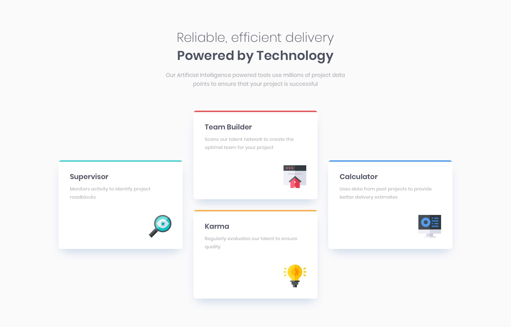
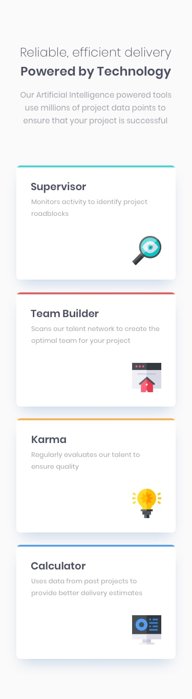

# Four Card Feature Section


[](https://andrestorresaioros.github.io/front/)

Solución al reto **Four Card Feature Section** de [Frontend Mentor](https://www.frontendmentor.io/), maquetado con HTML y CSS a partir del diseño y la guía de estilos originales.

**Demo:** https://andrestorresaioros.github.io/front/

## Objetivos del reto

- Reproducir fielmente el diseño para móvil y escritorio.
- Disposición de las cuatro tarjetas (Supervisor, Team Builder, Karma y Calculator) en una cuadrícula que se adapta al ancho de pantalla.
- Uso de la paleta de colores y la tipografía definidas en `style-guide.md`.

## Capturas de referencia

| Escritorio | Móvil |
|---|---|
|  |  |

## Estructura

```
.
├── index.html       # Estructura de la página
├── styles.css       # Estilos y diseño responsive
├── style-guide.md   # Guía de estilos del reto
├── design/          # Diseños de referencia
└── images/          # Iconos y favicon
```

## Ejecución local

No requiere instalación. Abre `index.html` en el navegador o sirve la carpeta:

```bash
python -m http.server 8000
```

## Autor

**César Andrés Torres Bernal** · [GitHub](https://github.com/andrestorresaioros) · [LinkedIn](https://www.linkedin.com/in/andr%C3%A9s-torres10)

## Licencia

El código se distribuye bajo la licencia MIT ([LICENSE](LICENSE)). El diseño y los recursos gráficos pertenecen a Frontend Mentor.
